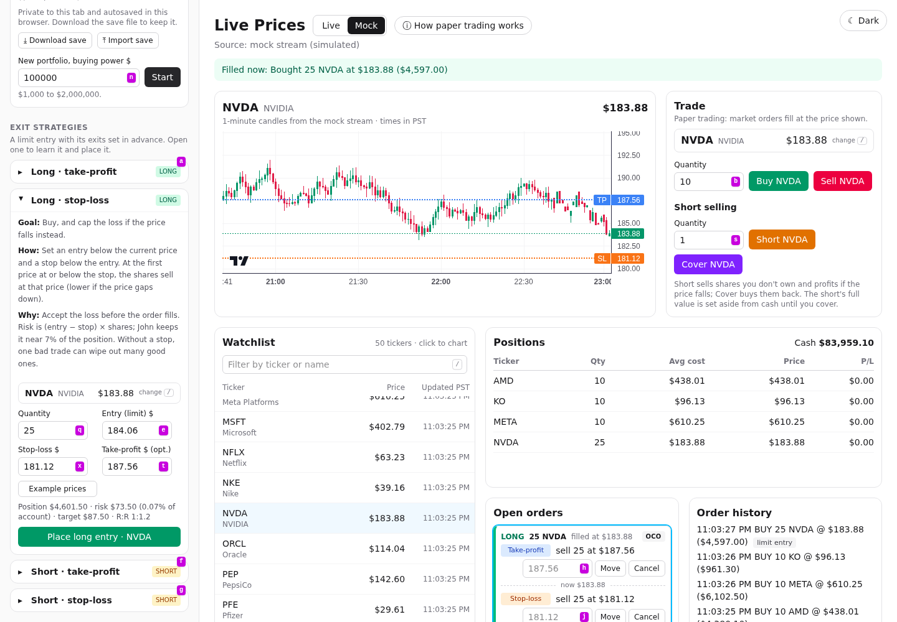
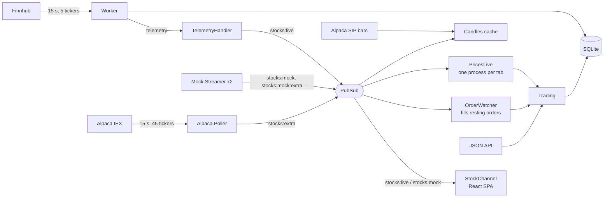

# Capstock

A **paper day-trading simulator** on real market prices, built with Elixir, Phoenix and
**LiveView**. You trade simulated money against live quotes, with limit entries, stop-losses,
take-profits and short selling, so you can test a strategy before risking anything real.

It is also an experiment: the same trading backend serves a **server-rendered LiveView app**
and an existing **React SPA**, and both were measured against each other on identical features.

| | Link |
|---|---|
| LiveView app (live prices) | https://capstock-backend.fly.dev/prices |
| LiveView app (mock prices, any time of day) | https://capstock-backend.fly.dev/prices?source=mock |
| React SPA (separate repo) | https://tinle-ri.github.io/CapStock_FrontEnd/ |



> **Paper trading only.** No real orders, brokers or money. Alpaca is used for market data only;
> fills, cash and positions are simulated by Capstock's own trading module.

---

## Features

### Trading
- **Market orders:** Buy, Sell, Short and Cover, filled at the price on screen. Shorts are
  cash-secured: the short's value is set aside from cash.
- **Limit entries with brackets:** a long or short limit entry with an optional **stop-loss** and
  **take-profit**. When it fills, both exits are created; when one exit fills, the other is
  cancelled (**OCO**).
- **Move an exit** (e.g. raise a stop to break-even). A price that would fill instantly is
  refused.
- **Strict, honest fills:** a limit needs the price to trade *through* it; a stop fills at the
  tick price, so a gap gives a worse fill. Live orders are rejected while the market is closed.

### Your portfolio, with no accounts
- Each browser tab gets a **private portfolio**. Nobody else can see or change it, and it is
  deleted from the server when the tab closes.
- **Autosave** in the browser: a reload picks up where you left off.
- **Signed save file:** download your portfolio as readable JSON and import it later. Any edit
  makes it refuse to load, so the record stays honest.
- **Choose your buying power** ($1,000 to $2,000,000), with account value and P/L since start.
  Starting over offers **Undo** instead of a confirm popup.

### Market data and chart
- **50 tickers:** 5 from Finnhub and 45 from Alpaca's free IEX feed, in one request every 15 s.
- **Candlestick chart:** 5-minute candles from Alpaca's full-market (SIP) history plus live ticks;
  1-minute candles on the mock stream. Times in the viewer's own time zone (PST, CST, …).
- **Click an open order** to draw its take-profit (blue) and stop-loss (orange) on the chart.
- **⟲ Reset view** returns the chart to automatic after you pan or zoom.

### Learn and plan
- **Exit-strategy sidebar:** Long/Short × take-profit/stop-loss, each with a goal/how/why
  tutorial, example prices and a **risk preview** (position size, $ and % at risk, target, R:R).
- **Open orders grouped by bracket**, as a small price ladder with the live price between the
  exits. **Order history** tags how each order was placed: manual, take-profit, stop-loss or
  limit entry.
- A **"How paper trading works"** panel.

### Keyboard first
- **`/`** focuses the watchlist filter: fuzzy search on ticker and company name, with
  **flash.nvim-style labels**. Press a result's letter to chart and select it.
- **Jump keys:** every number box shows a letter (b, s, q, e, x, t, n…), and the closed exit
  panels show a/d/f/g. **Esc** leaves a box.
- **Enter never places an order:** order buttons always take a click.

### React SPA (separate repo)
The original React frontend ([CapStock_FrontEnd](https://github.com/tinle-ri/CapStock_FrontEnd))
uses the same backend over a JSON API and a Phoenix channel. Its trading panel matches the
LiveView **Buy/Sell** panel field for field: that panel is the benchmark for the comparison below.

---

## Architecture



- **One poller per source, many viewers.** Pages never call a market-data API themselves;
  everything comes from the broadcast stream, the candle cache or the database.
- **Resting orders are database rows**, not process state. `OrderWatcher` checks them on every
  tick, so a crash or restart loses nothing, and stops keep working while no page is open.
- **Money is integer cents.** Every check-and-change is one conditional `UPDATE`, so concurrent
  orders, and races like cancel vs fill, can't double-spend or double-fill.
- **The server decides the price.** LiveView fills at the price its own process rendered; the
  API ignores any client price.
- **The React SPA is untouched by the LiveView-only features:** the extra tickers use separate
  topics, and the API only accepts Buy/Sell.

| Module | Role |
|---|---|
| `StockFetcher.Trading` | All trading rules: market orders (4 sides), resting orders, fills, OCO, moving exits, session portfolios |
| `Trading.SaveFile` | Signed JSON export and import of a portfolio |
| `Trading.SessionJanitor` | Deletes a tab's portfolio when its LiveView process exits |
| `StockFetcher.OrderWatcher` | Fills resting orders from the price stream (one per source) |
| `StockFetcher.Alpaca.Poller` | Live prices for 45 tickers (market data only) |
| `StockFetcher.Candles` | Chart history cache per source |
| `StockFetcher.Worker`, `Mock.Streamer` | Finnhub polling; simulated prices |
| `StockFetcherWeb.PricesLive` | The LiveView app at `/prices` |
| `TradingController`, `StockController`, `StockChannel` | JSON API and channel for the React SPA |
| `assets/js/app.js`, `flash.js` | LiveView hooks: chart, save file, flash labels, jump keys, local time |

### HTTP endpoints
| Route | Purpose |
|---|---|
| `GET /prices`, `/prices?source=mock` | LiveView app |
| `GET /api/health` | Health check |
| `GET /api/stocks`, `GET /api/stocks/:ticker/intraday` | Price history for the React SPA (rate-limited) |
| `GET /api/portfolio`, `POST /api/orders` | React trading panel (`{ticker, side, quantity}`; buy/sell only) |
| `/socket` (`stocks:live`, `stocks:mock`) | React live prices |
| `/live` | LiveView socket |

---

## LiveView vs React: what was measured

Measured on production with both UIs on the same backend and the same mock price stream, with
predictions written down first (details in [`LOG.md`](LOG.md)).

| Metric | LiveView | React |
|---|---|---|
| WebSocket bytes per price tick | 151 B | 123 B |
| Click → reply (median) | 46 ms | 52 ms |
| Reply to a successful order | a small diff | ~1.8 KB (whole portfolio) |
| Server memory per open tab | 110–145 KB | 27 KB |
| JS bundle, gzipped | 44 KB (97 KB with the chart) | 121 KB |

**The takeaway:** LiveView is about as cheap as React on the network, and cheaper per order. Its
real cost is **server memory**: every open tab is a process holding the page's state.

---

## Running it locally

**Requirements:** Elixir 1.18+ with Erlang/OTP 27. No Node.js needed: esbuild and Tailwind are
downloaded by Mix.

```zsh
git clone https://github.com/dxu13UW/stock_fetcher-CapStock_BACKEND.git
cd stock_fetcher-CapStock_BACKEND
mix deps.get
mix assets.setup
mix ecto.create && mix ecto.migrate
```

**API keys** go in a git-ignored `.env`. All are optional: without them the mock stream still
works.

```dotenv
FINNHUB_API_TOKEN="..."   # live prices for 5 tickers (free tier)
ALPACA_KEY_ID="..."       # live prices for 45 more + candle history (free paper account,
ALPACA_SECRET="..."       # market data only)
```

```zsh
set -a; source .env; set +a      # load the keys into the shell
mix phx.server                   # http://localhost:4000/prices?source=mock
```

**Checks** (run before every commit):

```zsh
mix format
mix compile --warnings-as-errors
mix test                         # 181 tests
```

## Deploying (Fly.io)

```zsh
fly secrets set SECRET_KEY_BASE=... FINNHUB_API_TOKEN=... ALPACA_KEY_ID=... ALPACA_SECRET=...
fly deploy
```

- The `Dockerfile` builds the assets (`mix assets.deploy`) into the release, and migrations run
  on boot.
- Production is a single machine with SQLite on a volume. The default machine is 256 MB, so
  measure the memory of anything that loads data at boot.
- **Abuse guards:** connection limits at Fly's proxy (`fly.toml`), per-IP connection and per-tab
  event limits in the LiveView, WebSocket frame caps, a memory ceiling per LiveView process, and
  per-IP rate limits on the JSON API.

---

## Project documents

| File | What it is |
|---|---|
| [`PLAN.md`](PLAN.md) | The agreed plan: user, scope, approach, metrics, schedule, risks |
| [`LOG.md`](LOG.md) | Dated log of decisions, user feedback, metrics and LiveView vs React observations |
| [`CLAUDE.md`](CLAUDE.md) | Instructions for the AI coding agent (Claude Code) used on this project |

Built by **Daniel Xu** for TCSS 490 (Generative AI and Software Development), University of
Washington, Artifact 4 "For Someone Else". The user is a day trader interviewed for the project
(pseudonym "John Daytrader" at their request). Developed with Claude Code as an AI pair
programmer; see `LOG.md` for who wrote what.

## Credits

- Market data: [Finnhub](https://finnhub.io) and [Alpaca](https://alpaca.markets) (IEX real-time
  trades; SIP historical bars, 15 minutes delayed on the free tier).
- Charts: [TradingView Lightweight Charts™](https://www.tradingview.com/lightweight-charts/),
  Copyright © 2025 TradingView, Inc., Apache License 2.0 (vendored in `assets/vendor/`).
